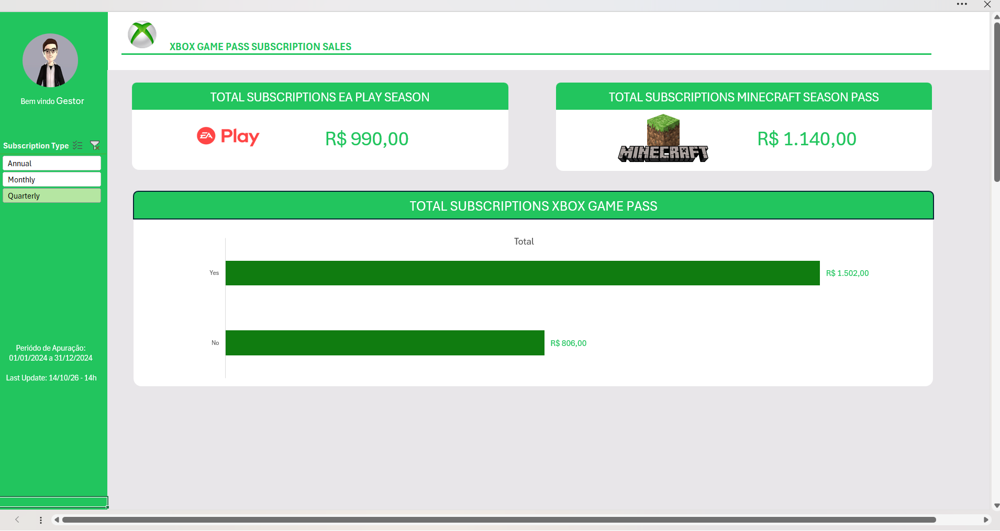

# 📊 Dashboard de Vendas — Xbox Game Pass

*Dashboard no Excel, com o filtro de tipo de assinatura (Subscription Type) aplicado em **Quarterly**.*

## Sobre o projeto

Projeto desenvolvido como parte do **Bootcamp TOTVS — Fundamentos de Engenharia de Dados e Machine Learning**, na plataforma **DIO**, para o desafio de criação de um dashboard de vendas no Excel.

O objetivo é transformar dados de assinaturas do **Xbox Game Pass** em informações visuais para apoiar o acompanhamento de resultados e a tomada de decisões baseada em dados.

## Objetivos

- Organizar dados de assinaturas em uma base estruturada.
- Consolidar informações usando tabelas dinâmicas.
- Analisar o valor das assinaturas e de serviços adicionais.
- Apresentar indicadores em um dashboard visual no Excel.

## Base de dados

A planilha contém registros de assinantes com os campos: identificador e nome do assinante, plano contratado (**Core**, **Standard** ou **Ultimate**), data de início, renovação automática, preço da assinatura, periodicidade (**mensal**, **trimestral** ou **anual**), contratação e preço dos passes **EA Play** e **Minecraft**, valor de cupom e valor total.

O dashboard apresenta o período de apuração de **01/01/2024 a 31/12/2024**.

## Indicadores e análises

A aba de cálculos usa tabelas dinâmicas para consolidar indicadores com filtro de assinatura **anual**:

| Indicador | Valor exibido |
| --- | ---: |
| Soma de `Total Value` para planos anuais | 1.754 |
| Soma de `EA Play Season Pass` para planos anuais | 600 |
| Soma de `Minecraft Season Pass Price` para planos anuais | 940 |

Na análise de `Total Value`, o resultado aparece segmentado pela opção de renovação automática: **Yes = 1.537** e **No = 217**.

> **Nota:** os valores são apresentados conforme registrados nos dados e nas tabelas dinâmicas da planilha. A moeda e a interpretação dos campos devem seguir a configuração da base original.

## Estrutura do arquivo

- **A̳ssets:** paleta de cores e recursos visuais usados no dashboard.
- **B̳ases:** dados de origem, organizados em tabela.
- **C̳álculos:** perguntas de negócio e tabelas dinâmicas.
- **D̳ashboard:** apresentação visual dos indicadores de vendas e assinaturas.

## Ferramentas e recursos

- **Microsoft Excel**
- Tabelas e tabelas dinâmicas
- Consolidação e análise de dados
- Elementos visuais e formatação de dashboard

## Como reproduzir

1. Baixe o arquivo `Dashboard Vendas xbox Game Pass.xlsx` neste repositório.
2. Abra-o no **Microsoft Excel** (preferencialmente na versão para desktop).
3. Consulte a aba **B̳ases** para conhecer os dados.
4. Acesse a aba **C̳álculos** para verificar os indicadores e tabelas dinâmicas.
5. Abra a aba **D̳ashboard** para visualizar o painel.
6. Caso altere a base, use **Dados > Atualizar Tudo** no Excel para atualizar as tabelas dinâmicas.

## Aprendizados

O desafio permitiu praticar a organização de dados, o uso de tabelas dinâmicas, a formulação de perguntas de negócio e a comunicação de indicadores por meio de um dashboard.

## Formação

**DIO — Bootcamp TOTVS: Fundamentos de Engenharia de Dados e Machine Learning**

## Autor

**Diego dos Santos**  
[GitHub](https://github.com/diegodossantos001-max)
